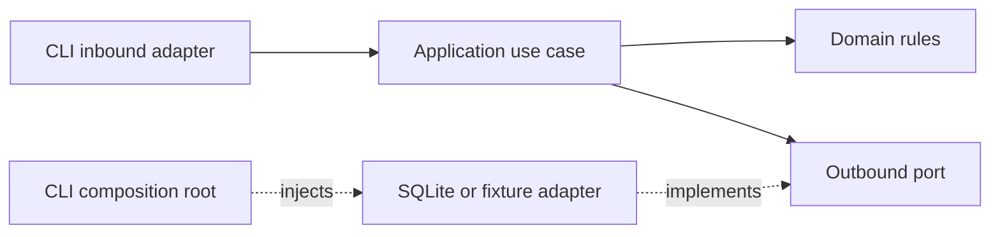

# Hexagonal Architecture Labs

Two independent, runnable examples of ports and adapters by **Daniel Duran**. Explore my work at **https://www.dan1el64.com/**.

These examples connect full-stack business rules with infrastructure validation and AI evaluation workflows. They use Python's standard library only: no accounts, API keys, paid services or client material.

[Published case study](https://www.dan1el64.com/portafolio#evaluacion-ia) · [Detailed architecture diagrams](docs/architecture.md)

## Run locally

Requires Python 3.11+. Run from the repository root:

```bash
python -m unittest discover -s tests -v
python -m labs.inventory.cli
python -m labs.inventory.cli --adapter sqlite --request-id demo-001
python -m labs.inventory.cli --adapter sqlite --request-id demo-001
python -m labs.evaluation.cli
```

Both SQLite invocations return remaining stock **8**: replaying a request does not deduct twice. Memory storage resets per invocation; SQLite persists to a local ignored database.

The evaluation demo intentionally reports **1 passed / 3 cases**. Negative fixtures demonstrate missing required terms and a forbidden instruction. Use `--fail-on-rejection` to return exit code 1 when any case fails. This is an educational substring rubric with synthetic recorded responses, not a live LLM integration, model benchmark or semantic quality claim.

## Examples

| Context | Business rule | Outbound port | Replaceable adapter |
| --- | --- | --- | --- |
| Inventory | Reserve positive quantities without overselling; idempotent request IDs | ReservationStore | In-memory / transactional SQLite |
| Response evaluation | Report missing and forbidden rubric terms; reject duplicate case IDs | ResponseProvider | Synthetic fixture provider / custom provider |



The domain and application do not import SQLite, filesystem APIs or CLI frameworks. `Protocol` defines structural contracts; the composition root chooses concrete adapters. An AST-based architecture test enforces the boundary.

## Design decisions

- **Atomic inventory port:** checking stock, idempotency and writing the reservation happen in one transaction. Splitting them across naive read/write ports would permit overselling.
- **SQLite concurrency:** `BEGIN IMMEDIATE` serializes writers; conditional updates protect stock. One connection per worker, with an integration test using two competing reservations.
- **Explicit failures:** rejected reservations leave stock unchanged; missing response fixtures fail the run instead of inflating pass rates.
- **Provider boundary:** an actual LLM adapter can implement `generate(case)` without changing the use case. Timeouts, retries, privacy and cost controls belong in that future adapter.

See [architecture and tradeoffs](docs/architecture.md) [extension exercises](docs/exercises.md) and the [Spanish interview walkthrough](docs/interview-walkthrough.md).

## Verification and limits

Tests cover adapter contracts, persistence, competing reservations, invalid input, idempotency conflicts, rubric rejection reasons and architecture boundaries. GitHub Actions is configured for Python 3.11–3.13; check the Actions tab for actual hosted results.

Teaching examples, not production services: no HTTP authentication, migrations, distributed transactions, semantic judge, telemetry backend or deployment. SQLite is a local persistence example, not a distributed inventory platform. No claims of model-training results or client ownership are made.

## Español

Dos ejemplos independientes para explicar arquitectura hexagonal en entrevistas: reservas de inventario y evaluación de respuestas para IA. Incluyen reglas de dominio, casos de uso, puertos, adaptadores y pruebas. El evaluador usa respuestas sintéticas; no llama a un LLM ni reutiliza tareas de Revelo.

Original example code: Daniel Duran. [MIT License](LICENSE).
