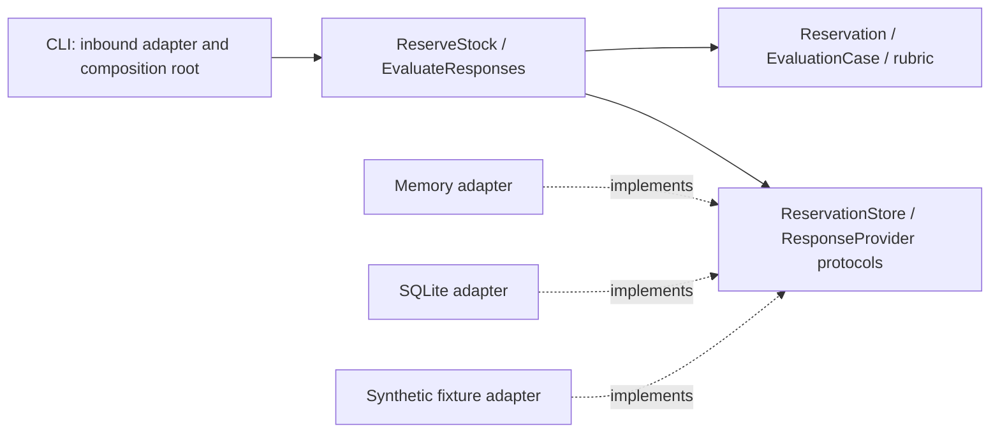
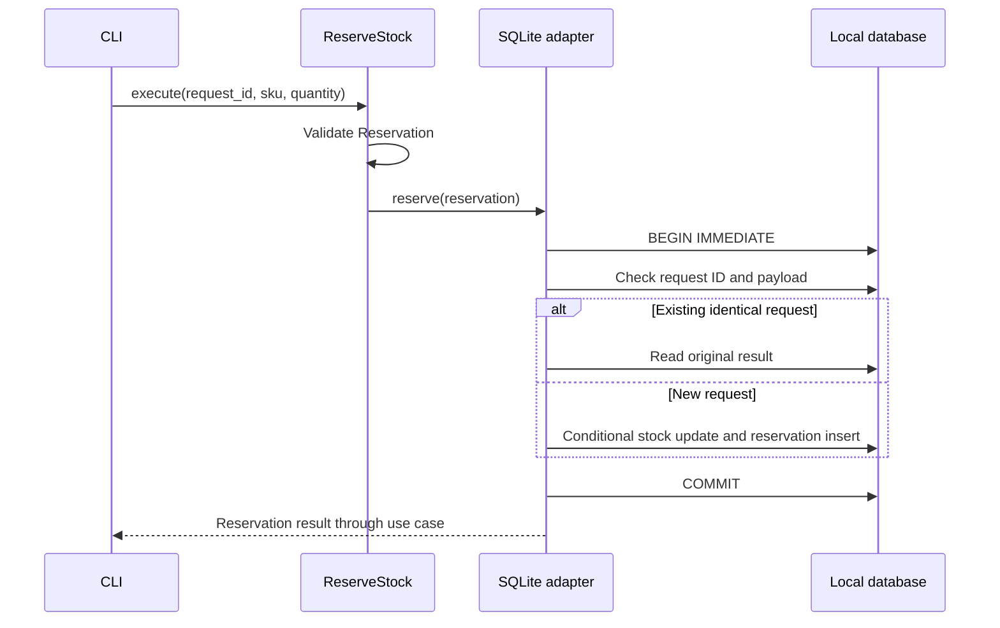

# Architecture and tradeoffs

Each bounded context has a domain, application use case, port and adapters. The CLI is an inbound adapter and composition root. It constructs outbound adapters and injects them into the application. The filesystem dataset loader stays outside the core.

## Dependency direction

Solid arrows show source dependencies. Dashed arrows show implementation of a port. At runtime, injected adapters receive calls through those ports. Inventory and evaluation remain separate bounded contexts; they do not share business entities.

## Inventory

`Reservation` rejects empty identifiers and quantities that are not positive integers, including Python booleans. `ReserveStock` translates the request into a domain value and delegates the atomic operation to `ReservationStore`.

The persistence contract deliberately includes the transaction boundary. A check-then-write service with separately exposed get/save operations could pass unit tests and still oversell under concurrent requests. SQLite uses a write transaction and a conditional update; the memory adapter serializes its mutation with a lock. The same behavioral contract tests exercise both adapters. Persistence and concurrency tests additionally exercise SQLite.

An idempotency key identifies the full request. The same key and payload return the original reservation. A different payload with the same key is rejected. Insert-only initialization avoids accidental inventory replenishment after restarting the CLI.

For production, add migrations, structured business error mapping, an explicit SKU lifecycle, stock adjustments, reservation expiration, authentication and authorization. A SQL adapter would need database-specific concurrency tests. Do not assume this SQLite demonstration solves distributed consistency.

Conflicting request payloads and insufficient stock raise errors and roll back. The transaction boundary belongs to the atomic store contract, rather than separate read/write ports.

## Response evaluation

The domain owns the rubric and verdict, not a model SDK. The application requests a response through a protocol and evaluates it. The supplied adapter returns synthetic recorded answers. The dataset contains one positive and two deliberately negative examples.

Substring matching is transparent and deterministic, but it can reward keyword stuffing and reject paraphrases. It does not verify that Terraform is valid, that code is secure or that an answer is semantically correct. An independent syntax/test runner and a human-reviewed rubric would provide stronger evidence. Do not execute arbitrary model-generated code on the host.

A future model adapter should record model/version, prompt and dataset revision, latency, usage and errors, with explicit privacy and budget controls. Separate infrastructure errors from quality failures; do not silently replace failed requests with a passing fixture. A future report repository would be another outbound port once persistence is a real requirement.

## Why two contexts

Business inventory and evaluation are different domains. They share an architectural style, not entities or business services. Keeping them independent avoids a generic service layer with unrelated responsibilities. Tests enforce inward dependencies; folder names alone do not establish hexagonal architecture.

## Public walkthrough

[Published evaluation case study](https://www.dan1el64.com/portafolio#evaluacion-ia) · [Interview guide in Spanish](interview-walkthrough.md).
